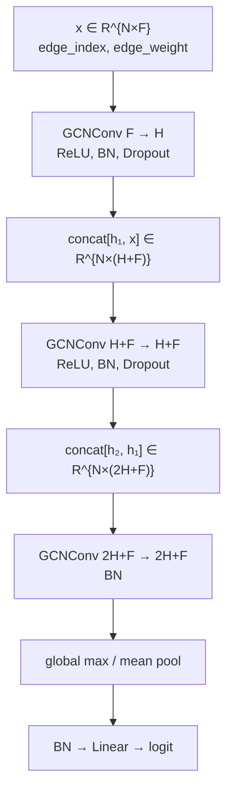
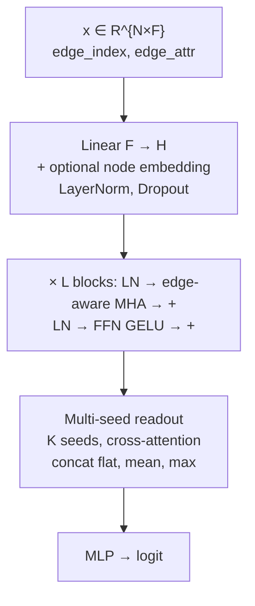
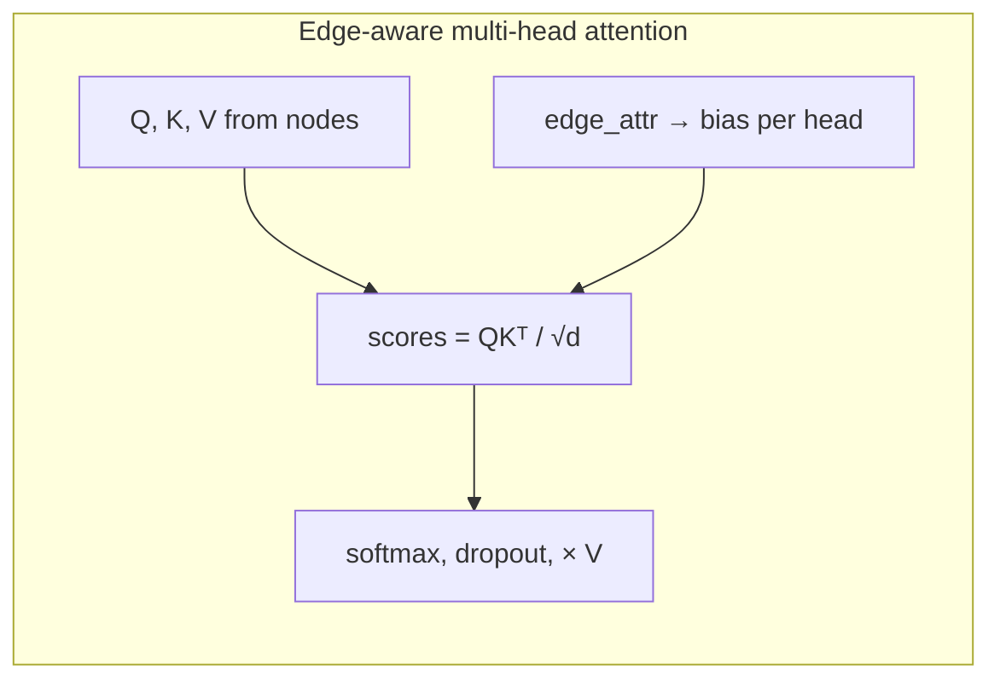

# HCP graph representations: baselines, SkipGCN, CF-MSR

[Русский](README.ru.md)

Code, Hydra configs, and launch scripts that produce
[`report_baselines_gnn.md`](report_baselines_gnn.md): a comparison of four edge
constructions on HCP task-fMRI graphs, linear baselines, a simple GCN
(**SkipGCN**), and a dense-graph transformer (**CF-MSR**).

The graph archive is **not** in this repository (~94 GB). Point `data.root` in
[`conf/data.yaml`](conf/data.yaml) at a local copy of `hcp_mmp_mean_ablation_graphs`
(dataset id `hcp_rl_2026_10_14`).

## What the report answers

1. Which edge representation is best on **linear** classifiers when test is all
   four outer folds (832 subjects).
2. Whether a GNN (**SkipGCN**) is needed on the same comparison (outer fold 0),
   and whether SkipGCN overfit.
3. How a simple GCN compares to **CF-MSR**, an edge-aware attention model built
   for dense graphs (smoke protocol, default hyperparameters).

Multiple-testing correction in the report is **Romano–Wolf step-down** (FWER),
with Holm as a robustness check. See the report for families, CIs, and caveats.

## Setup

Python ≥ 3.12, PyTorch 2.x, PyTorch Geometric. GPU recommended for GNN runs.

```bash
pip install -r requirements.txt
# edit conf/data.yaml → data.root = /path/to/hcp_mmp_mean_ablation_graphs
pytest tests/ -q
```

Tests that read graphs skip automatically if `data.root` is missing.

## Data (not shipped)

832 HCP participants, RL phase, MMP atlas (379 ROIs), regional mean time series.
Seven tasks, two states each, balanced labels (`y=1` is state2). Splits in
`splits.json` (seed 1): four outer folds, 624 / 208 subjects, both states of a
subject stay in the same fold. Three inner groups inside each outer train set.

| `variant` | Edge weight |
|-----------|-------------|
| `correlation` | Standardized Pearson (fold-independent) |
| `ensemble_correlation` | P(state2)−P(state1) from a per-edge logistic on `correlation_ij` |
| `ensemble_univariate` | Same on `[mean_i, mean_j, std_i, std_j]` |
| `ensemble_full` | Univariate features plus `correlation_ij` |

Ensemble edges are **supervised** and fold-specific (trained on that outer
train pool). Do not mix ensemble files across folds. Node features: `mean_std`
on `correlation`, constant `1` on ensemble (override with `data.node_features`).

## Models

### SkipGCN

A three-layer GCN with skip **concatenation** (not additive residuals). Edge
weights enter GCN as a scalar `edge_weight`. Graph readout is global max- or
mean-pool, then a linear classifier.

Default hyperparameters used in the report (frozen in `conf/best_task/` after
tuning on outer-0 train; 27/28 cells are these defaults):
`hidden_channels=32`, `dropout=0.2`, `global_max_pool`.
`correlation`/`EMOTION` uses a slightly different `lr`, `weight_decay`, `dropout`.



Implementation: [`skipgcn_model.py`](skipgcn_model.py) (`SkipGCN`, adapter
`SkipGCNForCFMSR`).

### CF-MSR

A transformer stack for **dense** graphs. Each block is pre-norm multi-head
attention plus an FFN. Attention logits get an additive **edge bias**:
`edge_attr → (BatchNorm) → Linear–GELU–Linear → per-head bias`. Optional
per-node embeddings. Graph readout uses **K learnable seed tokens**
(cross-attention over nodes) concatenated with mean and max of the seed
outputs, then an MLP.

Smoke defaults in the report: `hidden_dim=64`, `num_layers=2`, `num_heads=4`,
`num_seeds=4`, `drop_percentile=50`. No HPO for CF-MSR in this export.





Implementation: [`model.py`](model.py) (`EdgeMultiHeadAttention`, `CFMSRBlock`,
`MultiSeedReadout`, `CFMSR`). Factory: [`model_factory.py`](model_factory.py).

| | SkipGCN | CF-MSR |
|--|---------|--------|
| Message passing | `GCNConv` with scalar `edge_weight` | Dense attention + edge bias |
| Depth | 3 convolutions, skip concat | 2 transformer blocks (smoke) |
| Readout | global max / mean pool | 4 seed tokens + mean/max |
| Role in the report | Stage 2, frozen HP, outer 0 | Smoke only, default HP |

## Reproduce the report

Set `data.root`, then run the three experiment groups. Batch jobs resume:
`FINISHED` MLflow runs are skipped; `FAILED`/`RUNNING` are deleted.

```bash
# 1. Linear baselines, outer folds 0–3, one report per classifier
#    (top-n B=2000; logreg B=10000, feature set `all`)
bash scripts/run_baselines_cv.sh
# Optional: top-n curves only
PLOT_LANG=both bash scripts/run_top_n_edge_baseline.sh

# 2. SkipGCN stage 2 on outer 0 (3 inner × 3 seeds, HP from conf/best_task)
bash scripts/run_stage2_variants.sh
# Shuffled-label check (test AUC should be ~0.5)
bash scripts/run_leak_check.sh

# 3. SkipGCN vs CF-MSR smoke (default HP, 1 inner, 1 seed, no bootstrap)
bash scripts/run_smoke_defaults.sh
```

Single-cell examples:

```bash
python main_compare.py model=skipgcn variant=ensemble_full task=WM
python main_smoke.py model=cfmsr variant=correlation task=MOTOR
```

Outputs go to `artifacts/` (gitignored): MLflow `artifacts/mlflow.db`, baseline
tables, variant-comparison markdown. The numbers in
[`report_baselines_gnn.md`](report_baselines_gnn.md) are from those runs.

Stage-2 SkipGCN is on the order of a day per full 4×7 matrix on one GPU.
Baselines are minutes to tens of minutes (graph I/O, then cache). Smoke is
faster than stage 2 (one seed, one inner fold) but still 56 GNN trainings.

## Layout

```
main_compare.py / main_smoke.py   # Hydra entries (stage 2 / smoke)
train.py, crossval.py, dataset.py
model.py, skipgcn_model.py, model_factory.py
conf/                             # Hydra: data, variant, task, model, best_task
scripts/run_baselines_cv.sh
scripts/run_stage2_variants.sh
scripts/run_smoke_defaults.sh
scripts/run_leak_check.sh
report_baselines_gnn.md
figures/                          # pooled top-n AUC(n) curves used in the report
```

## License / data

Code in this folder is the experiment pipeline for the report. HCP graphs are
not redistributed here; obtain the archive separately and keep `splits.json`
with it.
