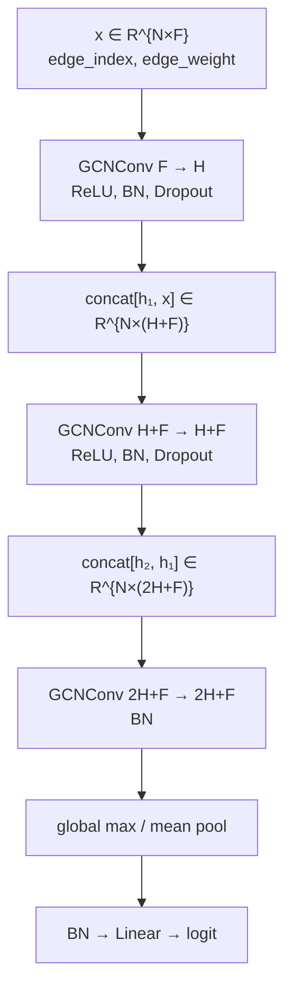
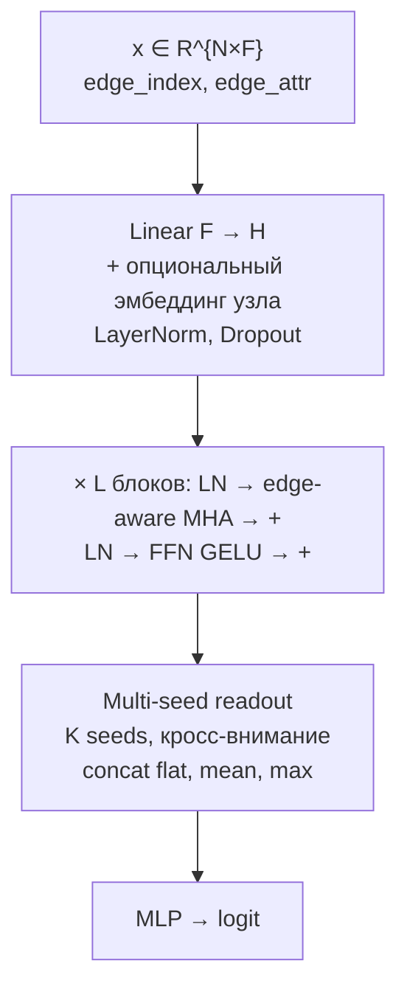
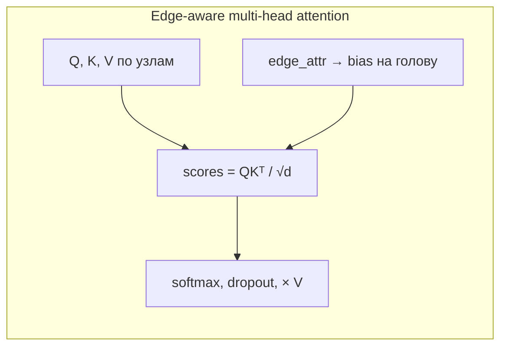

# Представления графов HCP: бейзлайны, SkipGCN, CF-MSR

[English](README.md)

Код, конфиги Hydra и скрипты запуска, по которым собран
[`report_baselines_gnn.md`](report_baselines_gnn.md): сравнение четырёх способов
задать рёбра на графах task-fMRI HCP, линейных классификаторов, простой GCN
(**SkipGCN**) и трансформера для плотных графов (**CF-MSR**).

Архив графов в репозиторий **не входит** (~94 ГБ). Укажите путь к локальной
копии `hcp_mmp_mean_ablation_graphs` (id `hcp_rl_2026_10_14`) в
[`conf/data.yaml`](conf/data.yaml) (`data.root`).

## Вопросы отчёта

1. Какое представление рёбер лучше на **линейных** классификаторах, если test —
   все четыре outer fold (832 субъекта).
2. Нужна ли GNN (**SkipGCN**) на том же сравнении (outer 0) и не переобучилась
   ли она.
3. Как простая GCN соотносится с **CF-MSR** — моделью с edge-aware attention
   для плотных графов (протокол smoke, дефолтные гиперпараметры).

Основная поправка на множественные сравнения — **Romano–Wolf step-down**
(FWER), Holm — проверка устойчивости. Семейства гипотез, CI и оговорки — в
отчёте.

## Установка

Python ≥ 3.12, PyTorch 2.x, PyTorch Geometric. Для GNN нужен GPU.

```bash
pip install -r requirements.txt
# conf/data.yaml → data.root = /path/to/hcp_mmp_mean_ablation_graphs
pytest tests/ -q
```

Тесты, которые читают графы, пропускаются, если архива нет.

## Данные (не поставляются)

832 участника HCP, фаза RL, атлас MMP (379 ROI), региональное среднее. Семь
задач, два состояния, классы сбалансированы (`y=1` — state2). Сплиты в
`splits.json` (seed 1): 4 outer fold, 624 / 208 субъектов; оба состояния
субъекта в одном fold. Внутри outer train — 3 inner-группы.

| `variant` | Вес ребра |
|-----------|-----------|
| `correlation` | стандартизованный Pearson (не зависит от fold) |
| `ensemble_correlation` | P(state2)−P(state1) логистической регрессии по `correlation_ij` |
| `ensemble_univariate` | то же по `[mean_i, mean_j, std_i, std_j]` |
| `ensemble_full` | univariate-признаки плюс `correlation_ij` |

Рёбра ensemble — **supervised** и привязаны к fold (обучение на train pool
этого outer). Файлы разных fold смешивать нельзя. Признаки узлов: `mean_std`
у `correlation`, константа `1` у ensemble (`data.node_features`).

## Модели

### SkipGCN

Три слоя GCN со skip через **конкатенацию** (не сумма). Вес ребра — скалярный
`edge_weight` в `GCNConv`. Readout — global max- или mean-pool, затем линейный
классификатор.

Дефолтные HP в отчёте (зафиксированы в `conf/best_task/` после подбора на
train outer 0; 27 из 28 ячеек — эти значения): `hidden_channels=32`,
`dropout=0.2`, `global_max_pool`. У `correlation`/`EMOTION` другие `lr`,
`weight_decay`, `dropout`.



Код: [`skipgcn_model.py`](skipgcn_model.py) (`SkipGCN`, адаптер
`SkipGCNForCFMSR`).

### CF-MSR

Стек трансформерных блоков для **плотных** графов. В блоке: pre-norm
многоголовое внимание и FFN. К логитам внимания добавляется **смещение с
ребра**: `edge_attr → (BatchNorm) → Linear–GELU–Linear → bias на голову`.
Опциональные эмбеддинги узлов. Readout: **K обучаемых seed-токенов**
(кросс-внимание по узлам), конкатенация с mean и max, затем MLP.

Дефолты smoke в отчёте: `hidden_dim=64`, `num_layers=2`, `num_heads=4`,
`num_seeds=4`, `drop_percentile=50`. Подбора HP у CF-MSR в этом экспорте нет.





Код: [`model.py`](model.py) (`EdgeMultiHeadAttention`, `CFMSRBlock`,
`MultiSeedReadout`, `CFMSR`). Фабрика: [`model_factory.py`](model_factory.py).

| | SkipGCN | CF-MSR |
|--|---------|--------|
| Обмен по рёбрам | `GCNConv` со скалярным `edge_weight` | плотное внимание + bias с ребра |
| Глубина | 3 свёртки, skip-конкатенация | 2 трансформерных блока (smoke) |
| Readout | global max / mean pool | 4 seed-токена + mean/max |
| В отчёте | stage 2, зафиксированные HP, outer 0 | только smoke, дефолтные HP |

## Как воспроизвести отчёт

Задайте `data.root` и запустите три группы. Батч-скрипты возобновляемые:
`FINISHED` в MLflow пропускаются, `FAILED`/`RUNNING` удаляются.

```bash
# 1. Линейные бейзлайны, outer fold 0–3, один отчёт на классификатор
#    (top-n B=2000; logreg B=10000, набор признаков `all`)
bash scripts/run_baselines_cv.sh
# По желанию: только кривые top-n
PLOT_LANG=both bash scripts/run_top_n_edge_baseline.sh

# 2. SkipGCN stage 2 на outer 0 (3 inner × 3 seed, HP из conf/best_task)
bash scripts/run_stage2_variants.sh
# Проверка с перемешанными метками (test AUC ≈ 0.5)
bash scripts/run_leak_check.sh

# 3. SkipGCN vs CF-MSR smoke (дефолтные HP, 1 inner, 1 seed, без bootstrap)
bash scripts/run_smoke_defaults.sh
```

Один прогон:

```bash
python main_compare.py model=skipgcn variant=ensemble_full task=WM
python main_smoke.py model=cfmsr variant=correlation task=MOTOR
```

Результаты пишутся в `artifacts/` (в git не входит): MLflow
`artifacts/mlflow.db`, таблицы бейзлайнов, markdown сравнения вариантов.
Числа в [`report_baselines_gnn.md`](report_baselines_gnn.md) взяты из этих
прогонов.

Полная матрица SkipGCN stage 2 — порядка суток на одном GPU. Бейзлайны —
минуты–десятки минут (чтение графов, затем кэш). Smoke быстрее stage 2 (один
seed и один inner), но это всё равно 56 обучений GNN.

## Структура

```
main_compare.py / main_smoke.py   # точки входа Hydra (stage 2 / smoke)
train.py, crossval.py, dataset.py
model.py, skipgcn_model.py, model_factory.py
conf/                             # Hydra: data, variant, task, model, best_task
scripts/run_baselines_cv.sh
scripts/run_stage2_variants.sh
scripts/run_smoke_defaults.sh
scripts/run_leak_check.sh
report_baselines_gnn.md
figures/                          # pooled-кривые AUC(n) из отчёта
```

## Данные и распространение

В этой папке — пайплайн экспериментов отчёта. Графы HCP сюда не входят:
архив нужно получить отдельно и хранить вместе с `splits.json`.
