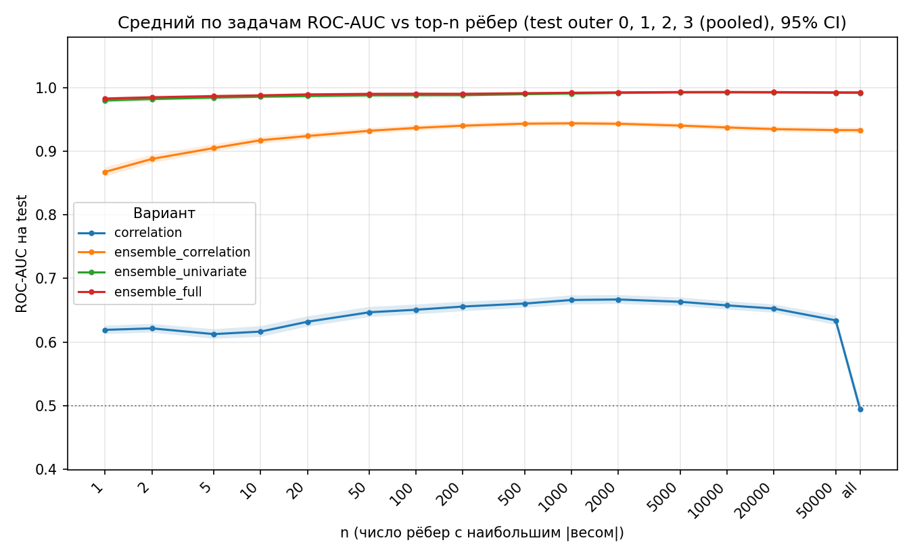

# Сравнение представлений графа, baseline и GNN

Этот файл — отчёт по экспериментам **этого** репозитория.
Архив графов `hcp_mmp_mean_ablation_graphs` сюда не входит: путь задаётся в
[`conf/data.yaml`](conf/data.yaml) (`data.root`). Как воспроизвести таблицы —
в [README.ru.md](README.ru.md) / [README.md](README.md). Архитектуры SkipGCN и
CF-MSR описаны там же. CSV и MLflow пишутся в `artifacts/` (каталог в
`.gitignore`); числа ниже уже посчитаны.

Вопрос в трёх частях.

1. Какое из четырёх представлений рёбер лучше разделяет два состояния задачи HCP
   на линейных классификаторах, если test — все четыре outer fold.
2. Нужна ли графовая сеть (SkipGCN), если то же сравнение сделать на outer 0.
3. Как простая GNN (SkipGCN) соотносится с CF-MSR — моделью с edge-aware attention
   и seed-токенами, рассчитанной на плотные графы.

Числа — ROC-AUC. Доверительные интервалы — кластерный bootstrap по субъектам
(оба состояния субъекта ресемплируются вместе). Источники таблиц указаны в каждом разделе.

## Условия, общие для всех частей

Архив `hcp_mmp_mean_ablation_graphs` (id `hcp_rl_2026_10_14`). Когорта: 832 участника HCP,
фаза RL, атлас MMP (379 ROI), сигнал — пространственное среднее региона. 7 задач,
метки state1 → y=0, state2 → y=1, классы 832/832. Сплит `splits.json`, seed 1, 4 outer
(каждый субъект в test ровно одного fold; оба состояния субъекта в одном fold).

| Вариант | Вес ребра |
|---|---|
| `correlation` | Pearson, стандартизованный внутри EV-блока по верхнему треугольнику, блоки усреднены |
| `ensemble_correlation` | P(state2)−P(state1) логистической регрессии по одному признаку `correlation_ij` |
| `ensemble_univariate` | то же по `[mean_i, mean_j, std_i, std_j]` |
| `ensemble_full` | univariate-признаки плюс `correlation_ij` |

Три ensemble — абляция признаков одной и той же рёберной регрессии (L2, C=1), обученной
на train соответствующего outer. Это supervised-веса, а не независимые коннектомы.
`correlation` от fold не зависит.

### Поправка на множественные сравнения

Семейства заданы заранее: основное — каждый ensemble против эталона `correlation`
(7 задач + MEAN, 24 гипотезы); вторичное — пары ensemble между собой (ещё 24).

**Основная поправка — Romano–Wolf step-down (FWER).** Она использует совместное
bootstrap-распределение всех ΔAUC семейства и учитывает зависимость гипотез
(общие субъекты, парный bootstrap, строка MEAN). Holm — проверка устойчивости
(FWER без модели зависимости). Benjamini–Hochberg — разведочный FDR, в вердиктах
не используется.

Вывод «значимо» ниже означает p_RW < 0.05 и p_Holm < 0.05 при α=0.05 (в тексте `RW+Holm`).
BH не берётся как основная: при 24 зависимых гипотезах FDR слишком либерален для
ранжирования представлений.

---

## 1. Baseline на всех outer fold (test 832 субъекта)

Модели без GNN. Знак скора / гиперпараметр `C` выбираются на train pool своего fold.
Test всех fold объединяются (pooled). CI — один кластерный bootstrap по 832 субъектам.

| Классификатор | Что видит | Отбор на train | Bootstrap |
|---|---|---|---|
| Top-n рёбер | среднее n рёбер с наибольшим \|w\| | n и знак по train AUC своего fold | B=2000 |
| LogReg, набор `all` (495 признаков) | блочные средние + вектор сил + сводки сил; StandardScaler → L2 | `C` по GroupKFold субъектов | B=10000 |

Pooled — основной результат. У LogReg macro (среднее по fold) совпадает с pooled
по знаку и значимости всех устойчивых выводов. У top-n macro не считался: сравнение
идёт по pooled при n, выбранном на train.

Источники (после запуска `bash scripts/run_baselines_cv.sh`):
`artifacts/baselines_cv/top_n/`, `artifacts/baselines_cv/logreg/all/`.
Парные ΔAUC top-n при выбранном n посчитаны из кэша скоров тем же протоколом,
что и сравнение вариантов SkipGCN (`scripts/compare_variants.py`).

### 1.1. Top-n: ROC-AUC при n, выбранном на train

n в таблице — лучший по train AUC (test в выборе не участвует). Сетка n от 1 до всех
рёбер верхнего треугольника.

| task | correlation | ensemble_correlation | ensemble_univariate | ensemble_full |
|---|---|---|---|---|
| EMOTION | 0.6708 [0.6487, 0.6940] | 0.9857 [0.9812, 0.9896] | 1.0000 [0.9999, 1.0000] | **1.0000 [0.9999, 1.0000]** |
| GAMBLING | 0.5422 [0.5225, 0.5617] | 0.8096 [0.7934, 0.8265] | 0.9776 [0.9692, 0.9855] | **0.9790 [0.9706, 0.9866]** |
| MOTOR | 0.5180 [0.4994, 0.5374] | 0.9963 [0.9943, 0.9979] | **1.0000 [1.0000, 1.0000]** | **1.0000 [1.0000, 1.0000]** |
| LANGUAGE | 0.9895 [0.9827, 0.9953] | **1.0000 [1.0000, 1.0000]** | 1.0000 [1.0000, 1.0000] | **1.0000 [1.0000, 1.0000]** |
| SOCIAL | 0.7414 [0.7212, 0.7615] | 0.9585 [0.9498, 0.9667] | 0.9987 [0.9962, 1.0000] | **0.9987 [0.9962, 1.0000]** |
| RELATIONAL | 0.7591 [0.7411, 0.7769] | 0.8900 [0.8757, 0.9039] | 0.9725 [0.9651, 0.9793] | **0.9758 [0.9692, 0.9821]** |
| WM | 0.8026 [0.7863, 0.8193] | 0.9694 [0.9627, 0.9762] | 0.9986 [0.9975, 0.9994] | **0.9987 [0.9978, 0.9995]** |
| MEAN | 0.7177 [0.7102, 0.7251] | 0.9442 [0.9404, 0.9483] | 0.9925 [0.9908, 0.9940] | **0.9932 [0.9916, 0.9947]** |

Все 24 гипотезы основного семейства значимы (`RW+Holm`): каждый ensemble выше
`correlation` на каждой задаче и по среднему. Крупнейший разрыв — MOTOR
(+0.48) и GAMBLING (+0.27…+0.44). LANGUAGE уже почти потолок у `correlation`
(одно ребро, n=1, AUC 0.9895), ΔAUC +0.0105 всё равно `RW+Holm`.

Вторичное семейство, MEAN:

| a | b | ΔAUC [95% CI] | p_RW | вывод |
|---|---|---|---|---|
| ensemble_correlation | ensemble_univariate | +0.0483 [+0.0443, +0.0522] | 0.0005 | RW+Holm |
| ensemble_correlation | ensemble_full | +0.0490 [+0.0450, +0.0529] | 0.0005 | RW+Holm |
| ensemble_univariate | ensemble_full | +0.0007 [+0.0005, +0.0009] | 0.0015 | RW+Holm |

`ensemble_full` статистически выше `ensemble_univariate` по среднему, но на +0.0007.
По задачам эта пара значима только на RELATIONAL (+0.0034). Для выбора представления
это ничья: достаточно `ensemble_univariate`.

Кривые AUC(n) по всем четырём test-fold (pooled, B=2000):

У `correlation` потолок среднего около 0.67 (n≈1000–2000); GAMBLING и MOTOR остаются
около 0.5 при любом n. У трёх ensemble уже n=1 даёт средний AUC 0.87 / 0.98 / 0.98.

### 1.2. LogReg на признаках графа (набор `all`)

| task | correlation | ensemble_correlation | ensemble_univariate | ensemble_full |
|---|---|---|---|---|
| EMOTION | 0.9523 [0.9425, 0.9617] | 0.9948 [0.9922, 0.9970] | **1.0000 [1.0000, 1.0000]** | 1.0000 [0.9999, 1.0000] |
| GAMBLING | 0.7906 [0.7708, 0.8100] | 0.9017 [0.8888, 0.9143] | 0.9891 [0.9837, 0.9937] | **0.9899 [0.9847, 0.9943]** |
| MOTOR | 0.9411 [0.9300, 0.9517] | 0.9995 [0.9990, 0.9999] | **1.0000 [1.0000, 1.0000]** | **1.0000 [1.0000, 1.0000]** |
| LANGUAGE | **1.0000 [1.0000, 1.0000]** | **1.0000 [1.0000, 1.0000]** | **1.0000 [1.0000, 1.0000]** | **1.0000 [1.0000, 1.0000]** |
| SOCIAL | 0.9964 [0.9929, 0.9991] | 0.9989 [0.9979, 0.9996] | 0.9997 [0.9989, 1.0000] | **0.9998 [0.9993, 1.0000]** |
| RELATIONAL | 0.9194 [0.9072, 0.9309] | 0.9627 [0.9544, 0.9704] | 0.9872 [0.9810, 0.9920] | **0.9887 [0.9827, 0.9932]** |
| WM | 0.9589 [0.9504, 0.9670] | 0.9888 [0.9843, 0.9925] | 0.9994 [0.9988, 0.9998] | **0.9995 [0.9990, 0.9998]** |
| MEAN | 0.9369 [0.9325, 0.9412] | 0.9780 [0.9757, 0.9803] | 0.9965 [0.9953, 0.9975] | **0.9968 [0.9957, 0.9978]** |

Основное семейство, MEAN: `ensemble_correlation` / `univariate` / `full` выше `correlation`
на +0.041 / +0.060 / +0.060 (`RW+Holm`). То же на 5 задачах из 7. LANGUAGE — потолок
у всех четырёх. SOCIAL: `full` против `correlation` значим только по Romano–Wolf
(p_RW=0.046, p_Holm=0.20) — не устойчиво; macro эту пару не подтверждает.

Вторичное, MEAN:

| a | b | ΔAUC [95% CI] | p_RW | вывод |
|---|---|---|---|---|
| ensemble_correlation | ensemble_univariate | +0.0184 [+0.0161, +0.0208] | 0.0001 | RW+Holm |
| ensemble_correlation | ensemble_full | +0.0188 [+0.0165, +0.0211] | 0.0001 | RW+Holm |
| ensemble_univariate | ensemble_full | +0.0004 [+0.0001, +0.0006] | 0.026 | RW+Holm |

Снова ничья `univariate` ≈ `full`. Разрыв с `ensemble_correlation` живёт на GAMBLING
(+0.087) и RELATIONAL (+0.025).

Более бедные наборы признаков сохраняют тот же порядок вариантов (MEAN):
`block_means` 0.872 / 0.960 / 0.995 / 0.996; `strength_vector` 0.900 / 0.974 / 0.997 / 0.997.

### 1.3. Вывод части 1

Порядок представлений на линейных классификаторах и всех 832 test-субъектах один:

**`ensemble_full` ≈ `ensemble_univariate` > `ensemble_correlation` > `correlation`.**

Вывод устойчив к Holm и к macro у LogReg. `ensemble_full` не даёт практически
значимого выигрыша над `ensemble_univariate`. Высокий AUC ensemble — свойство
supervised-веса ребра: top-1 ребро уже даёт средний AUC 0.98 у `univariate`/`full`.
`correlation` линейно читается только после извлечения сил и блочных средних
(0.72 у top-n → 0.94 у LogReg), а не как среднее сильнейших рёбер.

---

## 2. SkipGCN на test outer 0 и необходимость GNN

Протокол stage 2: 3 inner × 3 seed = 9 моделей, test-вероятность — среднее.
HP зафиксированы ([`conf/best_task`](conf/best_task), подбор на train outer 0).
`drop_percentile=50`. У `correlation` на узлах `mean_std`, у ensemble — константа 1.
Bootstrap B=10000, 208 test-субъектов. Источник после
`bash scripts/run_stage2_variants.sh`: `artifacts/variant_comparison/skipgcn/report.md`.

Бейзлайны в этой части — тоже outer 0 (`artifacts/top_n_edge_baseline/` или
`artifacts/baselines_cv/top_n/` при `--outer-fold 0`;
`artifacts/graph_features_logreg/all/`), чтобы сравнение моделей шло на одном сплите.

### 2.1. Сравнение представлений на SkipGCN

| task | correlation | ensemble_correlation | ensemble_univariate | ensemble_full |
|---|---|---|---|---|
| EMOTION | 0.9170 [0.8830, 0.9461] | 0.9799 [0.9673, 0.9900] | **1.0000 [1.0000, 1.0000]** | **1.0000 [1.0000, 1.0000]** |
| GAMBLING | 0.8991 [0.8643, 0.9297] | 0.8056 [0.7726, 0.8380] | 0.9653 [0.9423, 0.9842] | **0.9691 [0.9471, 0.9866]** |
| MOTOR | 0.7365 [0.6886, 0.7820] | 0.9953 [0.9895, 0.9994] | **1.0000 [1.0000, 1.0000]** | **1.0000 [1.0000, 1.0000]** |
| LANGUAGE | 0.9989 [0.9967, 1.0000] | **1.0000 [1.0000, 1.0000]** | 1.0000 [0.9998, 1.0000] | 1.0000 [0.9998, 1.0000] |
| SOCIAL | 0.9277 [0.9006, 0.9516] | 0.9700 [0.9553, 0.9829] | **1.0000 [1.0000, 1.0000]** | **1.0000 [1.0000, 1.0000]** |
| RELATIONAL | 0.9364 [0.9087, 0.9594] | 0.8851 [0.8545, 0.9135] | 0.9676 [0.9492, 0.9826] | **0.9741 [0.9572, 0.9874]** |
| WM | 0.9771 [0.9638, 0.9876] | 0.9650 [0.9500, 0.9780] | 0.9988 [0.9964, 1.0000] | **0.9990 [0.9969, 1.0000]** |
| MEAN | 0.9132 [0.9016, 0.9239] | 0.9430 [0.9353, 0.9507] | 0.9902 [0.9860, 0.9938] | **0.9917 [0.9879, 0.9949]** |

`univariate` и `full` выше `correlation` на 6/7 задач и по среднему
(ΔAUC +0.077 и +0.079, `RW+Holm`). LANGUAGE не различается (потолок 0.999).
Между собой `univariate` и `full` значимо различаются только на RELATIONAL
(+0.006); по среднему +0.0015, p_RW=0.053 — ничья.

`ensemble_correlation` неоднороден: выше `correlation` на EMOTION, MOTOR, SOCIAL;
**ниже** на GAMBLING (−0.093) и RELATIONAL (−0.051), оба `RW+Holm`. На линейных
бейзлайнах этого провала нет. Среднее +0.030 неоднородность скрывает.

### 2.2. SkipGCN против линейных моделей на том же outer 0

Среднее по 7 задачам:

| Модель | correlation | ensemble_correlation | ensemble_univariate | ensemble_full |
|---|---|---|---|---|
| Top-n (лучший n по train) | 0.711 | 0.942 | 0.990 | 0.991 |
| SkipGCN | 0.913 [0.902, 0.924] | 0.943 [0.935, 0.951] | 0.990 [0.986, 0.994] | 0.992 [0.988, 0.995] |
| LogReg `all` | **0.937 [0.928, 0.945]** | **0.975 [0.969, 0.980]** | **0.996 [0.994, 0.998]** | **0.997 [0.994, 0.998]** |

На трёх ensemble SkipGCN повторяет top-n до 0.001 и не обгоняет LogReg.
Сигнал уже линейно читается из весов. GNN здесь не нужна.

На `correlation` картина другая и зависит от задачи (outer 0):

| task | Top-n | SkipGCN | LogReg `all` |
|---|---|---|---|
| EMOTION | 0.659 | 0.917 | **0.963** |
| GAMBLING | 0.530 | **0.899** | 0.790 |
| MOTOR | 0.509 | 0.737 | **0.934** |
| LANGUAGE | 0.994 | 0.999 | **1.000** |
| SOCIAL | 0.716 | 0.928 | **1.000** |
| RELATIONAL | 0.755 | **0.936** | 0.917 |
| WM | 0.814 | **0.977** | 0.955 |
| MEAN | 0.711 | 0.913 | **0.937** |

SkipGCN заметно выше top-n (особенно GAMBLING и MOTOR). Против LogReg на силах
и блочных средних SkipGCN в среднем проигрывает: MOTOR 0.737 против 0.934,
EMOTION 0.917 против 0.963. Выигрыш SkipGCN — GAMBLING (+0.11) и WM (+0.02).
Парный bootstrap между SkipGCN и LogReg на общих ресэмплах не считался;
это описание ячеек, не проверка ΔAUC.

**Нужна ли GNN.** На ensemble-графах — нет: линейный скор по рёбрам достаточен.
На сырой корреляции простая GCN лучше наивного top-n, но не лучше логистической
регрессии на узловых силах и блочных средних. Сравнивать архитектуры GNN
имеет смысл на `correlation`. На ensemble сравнение архитектур вырождено.

### 2.3. SkipGCN не переобучалась

Ранняя остановка по val loss (patience 15, окно сглаживания 3). Потолок эпох
150 (`correlation`) и 100 (ensemble). Ниже — среднее по 9 fold-run (3 inner × 3 seed)
в точке `best_epoch`. `gap` = train AUC − val AUC. Test — ансамбль 9 моделей
на outer 0. OOF — ROC-AUC на inner val тех же 9 моделей.

| variant | mean best epoch | train | val | gap | OOF | test outer 0 |
|---|---|---|---|---|---|---|
| correlation | 50 (max 101 из 150) | 0.904 | 0.918 | −0.014 | 0.921 | 0.913 |
| ensemble_correlation | 32 (max 95 из 100) | 0.916 | 0.930 | −0.014 | 0.931 | 0.943 |
| ensemble_univariate | 19 (max 50 из 100) | 0.989 | 0.993 | −0.004 | 0.994 | 0.990 |
| ensemble_full | 22 (max 64 из 100) | 0.991 | 0.995 | −0.004 | 0.995 | 0.992 |
| все 28 ячеек | 31 | 0.954 | 0.963 | −0.009 | 0.964 | 0.960 |

Факты против переобучения.

1. **Остановка далеко от потолка эпох.** Средняя лучшая эпоха 31. Ни одна из 28 ячеек
   не упирается в лимит 150/100: максимум 101 на `correlation`/WM. Модель не доучивается
   «до конца train».
2. **Val не хуже train.** Средний gap −0.009 (val чуть выше train — типично при dropout
   в точке ранней остановки). Ни в одной ячейке gap > 0.05. Худший gap −0.024
   (`correlation`/GAMBLING, `ensemble_correlation`/RELATIONAL) — val лучше train, не хуже.
3. **Test совпадает с val и OOF.** Среднее test − val = −0.003. Ни одна ячейка не падает
   больше чем на 0.02 относительно val. Test ≥ train в 25 из 28 ячеек.
4. **Слабая ячейка `correlation`/MOTOR (test 0.737) — недообучение, не переобучение.**
   Train 0.761, val 0.756, test 0.737. В smoke с дефолтными HP этот прогон дошёл до
   эпохи 100 из 100 (patience не сработал). LogReg на тех же графах даёт 0.934:
   сигнал в данных есть, SkipGCN его не вытягивает.
5. **Перемешанные метки (`shuffle_labels_scope=all`).** Шесть ячеек
   `ensemble_univariate`/`full` × EMOTION, MOTOR, SOCIAL: test AUC 0.483–0.521
   (MLflow `hcp_leak_all_*`, запуск `bash scripts/run_leak_check.sh`). Общей
   ошибки оценки нет. `scope=train` не запускался.

CI покрывают только выборку test-субъектов, не изменчивость обучения (seed, inner).
HP подбирались на субъектах outer 0, поэтому интервал на этом сплите слегка оптимистичен
относительно нового внешнего теста; это не переобучение в смысле train ≫ test.

### 2.4. Вывод части 2

Порядок представлений на SkipGCN тот же, что у baseline, с одним исключением:
`ensemble_correlation` проигрывает сырой корреляции на GAMBLING и RELATIONAL.
GNN не добавляет точности на ensemble. На `correlation` она нужна только если
не извлекать линейные признаки графа; иначе LogReg достаточен и в среднем выше.
Признаки переобучения SkipGCN на stage 2 отсутствуют.

---

## 3. SkipGCN против CF-MSR

CF-MSR ([`model.py`](model.py), схемы в README): стек трансформерных блоков с
**edge-aware multi-head attention**, опциональные эмбеддинги узлов, **seed-токены**
(num_seeds=4) для readout графа, FFN, классификатор. Это модель для плотных графов
с информативным весом ребра. SkipGCN ([`skipgcn_model.py`](skipgcn_model.py)):
три `GCNConv` со skip-конкатенацией и global max-pool — простая GCN без внимания
по рёбрам (вес ребра — скалярный `edge_weight` в GCN).

Единственная полная матрица 4 варианта × 7 задач × 2 модели — **smoke**
(`hcp_smoke_defaults_*`, `bash scripts/run_smoke_defaults.sh`): дефолтные HP,
1 inner fold, 1 seed, без bootstrap, outer 0, `drop_percentile=50`, эпохи ≤100,
patience 20. Stage 2 для CF-MSR не запускался, HPO у CF-MSR нет. Сравнивать
smoke CF-MSR со stage 2 SkipGCN нельзя: разный ансамбль и разные HP. Ниже —
только smoke против smoke.

### 3.1. Test ROC-AUC, smoke, outer 0

| variant | task | SkipGCN | CF-MSR | Δ (CF-MSR − SkipGCN) |
|---|---|---|---|---|
| correlation | EMOTION | 0.899 | **1.000** | +0.101 |
| correlation | GAMBLING | 0.888 | **0.969** | +0.082 |
| correlation | MOTOR | 0.737 | **1.000** | +0.263 |
| correlation | LANGUAGE | **0.999** | 0.998 | −0.002 |
| correlation | SOCIAL | 0.932 | **1.000** | +0.068 |
| correlation | RELATIONAL | 0.931 | **0.976** | +0.045 |
| correlation | WM | 0.971 | **0.998** | +0.028 |
| correlation | **MEAN** | 0.908 | **0.992** | **+0.084** |
| ensemble_correlation | EMOTION | **0.978** | 0.498 | −0.480 |
| ensemble_correlation | GAMBLING | **0.794** | 0.500 | −0.294 |
| ensemble_correlation | MOTOR | **0.994** | 0.993 | −0.001 |
| ensemble_correlation | LANGUAGE | **1.000** | 1.000 | 0.000 |
| ensemble_correlation | SOCIAL | **0.965** | 0.910 | −0.056 |
| ensemble_correlation | RELATIONAL | **0.884** | 0.459 | −0.425 |
| ensemble_correlation | WM | **0.964** | 0.871 | −0.093 |
| ensemble_correlation | **MEAN** | **0.940** | 0.747 | **−0.193** |
| ensemble_univariate | **MEAN** | **0.990** | 0.984 | −0.006 |
| ensemble_full | **MEAN** | **0.991** | 0.984 | −0.007 |

По ячейкам: CF-MSR выше в 8, ниже в 17, равно в остальных (потолок).

### 3.2. Как читать эти числа

**На `correlation` CF-MSR явно сильнее простой GCN.** Среднее 0.992 против 0.908.
Решающая ячейка — MOTOR: SkipGCN 0.737 (дошёл до эпохи 100 без ранней остановки,
train 0.779 / val 0.758), CF-MSR 1.000 уже на эпохе 2 (train 0.994 / val 1.000).
Edge-aware attention и seed-readout забирают сигнал из плотной корреляционной
матрицы, который трёхслойный GCN не собирает. На EMOTION, SOCIAL, GAMBLING разрыв
того же знака и тоже крупный. LANGUAGE у обеих на потолке.

Это согласуется с назначением CF-MSR: корреляционный граф после отсечения 50%
слабых рёбер всё ещё плотный, вес ребра — непрерывный, и именно его модель
читает через внимание.

**На ensemble дефолтный CF-MSR не устойчив, SkipGCN устойчив.**
Три ячейки `ensemble_correlation` (EMOTION, GAMBLING, RELATIONAL) у CF-MSR
схлопнулись: train AUC 0.45–0.49, test 0.46–0.50. Модель не нашла даже train-сигнал,
который SkipGCN и линейные бейзлайны читают. На `univariate`/`full` обе модели
у потолка, SkipGCN чуть выше (MEAN +0.006). Дополнительно у CF-MSR бывают ячейки
с train ≪ val (например `ensemble_correlation`/SOCIAL: train 0.51, val 0.93) —
нестабильность при тех же дефолтных HP.

Причина правдоподобна: вес ensemble — уже скор P(state2)−P(state1), знаковый
и другого масштаба, чем стандартизованный Pearson. Без подбора lr / edge-scaler /
readout CF-MSR на таких рёбрах расходится, а простая GCN с скалярным `edge_weight`
остаётся рабочей.

### 3.3. Вывод части 3

Простая GNN достаточна и даже предпочтительна на ensemble-графах: она не ломается
на дефолтных HP и повторяет линейный бейзлайн. Сложная модель для плотных графов
нужна на `correlation`: там CF-MSR закрывает провал SkipGCN (MOTOR и среднее +0.08)
и выходит на уровень, сопоставимый с потолком ensemble.

Оговорка. Это smoke, не stage 2: один seed, без CI, без HPO CF-MSR. Утверждение
«CF-MSR лучше SkipGCN на корреляции» опирается на 7 согласованных ячеек и на то,
что слабая ячейка SkipGCN (MOTOR) воспроизводится в stage 2 (test 0.737).
Утверждение «CF-MSR хуже на ensemble_correlation» описывает дефолтные HP, а не
потолок архитектуры. Для ранжирования моделей на корреляции нужен stage 2 CF-MSR
с CI и, по возможности, короткий HPO.

---

## Сводка

| Вопрос | Ответ |
|---|---|
| Лучшее представление на baseline, fold 0–3 | `ensemble_univariate` ≈ `ensemble_full` ≫ `ensemble_correlation` ≫ `correlation` (Romano–Wolf + Holm) |
| Нужен ли `ensemble_full` | Нет: ΔAUC vs `univariate` +0.0004…+0.0007 |
| Нужна ли GNN на ensemble | Нет: top-n и LogReg совпадают со SkipGCN |
| Нужна ли GNN на correlation | Простая GCN лучше top-n, хуже LogReg в среднем; CF-MSR на correlation сильнее обеих |
| Переобучалась ли SkipGCN | Нет: ранняя остановка, val ≥ train, test ≈ val, shuffle-AUC ≈ 0.5 |
| SkipGCN vs CF-MSR | На correlation выигрывает CF-MSR; на ensemble — SkipGCN (устойчивость дефолтных HP) |

Ограничения: CI не покрывают изменчивость обучения; HP SkipGCN и сравнение GNN —
только outer 0; CF-MSR без HPO и без bootstrap; парный тест SkipGCN vs LogReg
не считался; `scope=train` в leak-check не запускался.
